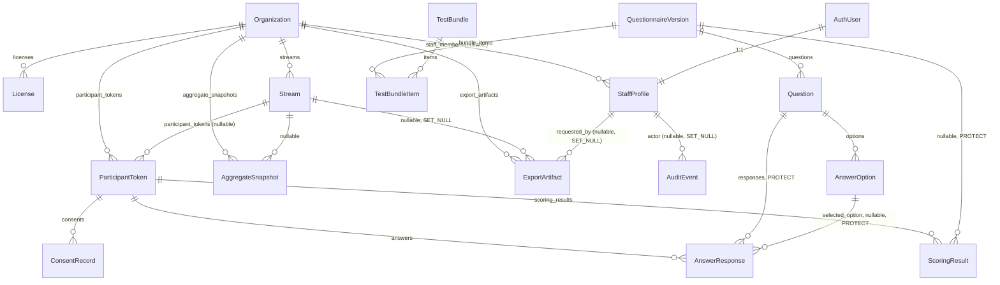

# Схема базы данных

Источник истины — модели Django (`backend/apps/*/models.py`) и миграции. Этот файл описывает их
словами и диаграммой, чтобы не читать весь код ради общей картины; при расхождении модели важнее
этого файла.

`ParticipantToken.is_test` (миграция `participants.0004`) отмечает тестовые прохождения:
итоговый этап доступен без семидневного ожидания, данные исключены из групповой аналитики.
Флаг по умолчанию false и недоступен для установки через API участника.

17 собственных таблиц (не считая `auth.User`, `authtoken.Token`, `django_admin_log` — это
Django/DRF, не наши):

| Приложение | Таблицы |
| --- | --- |
| `organizations` | Organization, License, Stream |
| `identity` | StaffProfile, AuditEvent |
| `participants` | ParticipantToken, ConsentRecord |
| `assessments` | QuestionnaireVersion, TestBundle, TestBundleItem, Question, AnswerOption, AnswerResponse, ScoringResult, IIPBResult |
| `reporting` | AggregateSnapshot, ExportArtifact |

## Диаграмма

`TestBundle.methodology` фиксирует формулу; `IIPBResult` хранит первый полный замер
по `(token,bundle,stage,version)` с датой версии, временем замера и JSON расчёта/исходных значений.
В `Organization` добавлены `specialist_contact` и `physician_contact`, доступные участнику
для маршрутизации. Миграции: `assessments.0007`, `organizations.0006`.



Текстовая версия той же схемы, по доменным границам:

```
┌──────────────────────────────── ORGANIZATIONS ────────────────────────────────┐
│                                                                                 │
│   ┌─────────────────┐        ┌───────────────────┐      ┌───────────────────┐ │
│   │   Organization   │──1:N──▶│      License       │      │       Stream       │ │
│   │  name            │        │  organization_id   │      │  organization_id  │ │
│   │  legal_name      │──1:N───────────────────────────────▶ code, status      │ │
│   │  entry_code      │        │  starts_at/ends_at  │      │  min_group_size   │ │
│   └────────┬─────────┘        │  status             │      └─────────┬─────────┘ │
│            │                  └────────────────────┘                │           │
└────────────┼───────────────────────────────────────────────────────┼───────────┘
             │ 1:N                                                     │ 1:N (nullable)
             ▼                                                         ▼
┌──────────────────────────────── PARTICIPANTS ──────────────────────────────────┐
│                                                                                   │
│   ┌──────────────────────┐        ┌───────────────────────┐                     │
│   │   ParticipantToken    │──1:N──▶│     ConsentRecord      │                    │
│   │  token (анонимный)    │        │  consent_type           │                   │
│   │  baseline_status/...  │        │  accepted, text_version │                   │
│   │  followup_status/...  │        └─────────────────────────┘                  │
│   │  report_payload       │                                                      │
│   └──────────┬────────────┘                                                     │
└──────────────┼──────────────────────────────────────────────────────────────────┘
               │ 1:N                              1:N
               ▼                                   ▼
┌──────────────────────────────── ASSESSMENTS ───────────────────────────────────┐
│                                                                                   │
│  ┌───────────────┐ 1:N  ┌──────────┐ 1:N  ┌─────────────┐        ┌─────────────┐│
│  │  TestBundle    │─────▶│TestBundle│      │  Question    │──1:N──▶ AnswerOption ││
│  │  code, is_active│     │  Item    │◀──1:N│ order, text   │        │ order, value ││
│  └───────────────┘      │  order   │      │ indicator_code│        └──────┬──────┘│
│                          └────┬─────┘      └──────┬───────┘               │       │
│                               │                     │                      │       │
│                               ▼ N:1                 │ 1:N                  │       │
│                     ┌──────────────────┐            ▼                     ▼       │
│                     │ QuestionnaireVersion│   ┌───────────────┐   ┌───────────────┐│
│                     │  code, version_label│   │ AnswerResponse │◀──┤(selected_option)││
│                     │  is_active           │   │  token_id      │   └───────────────┘│
│                     └──────────┬───────────┘   │  stage, raw_value│                  │
│                                │                └───────────────┘                   │
│                                │ nullable, PROTECT                                   │
│                                ▼                                                     │
│                     ┌──────────────────┐                                            │
│                     │   ScoringResult   │◀──── token_id (ParticipantToken)           │
│                     │  indicator_code    │                                           │
│                     │  raw_score, zone   │                                           │
│                     └──────────────────┘                                            │
└───────────────────────────────────────────────────────────────────────────────────┘

┌──────────────────────────────── IDENTITY ───────────────────────────────┐
│                                                                            │
│   auth.User (Django) ──1:1──▶ ┌─────────────┐        ┌───────────────┐  │
│                                 │ StaffProfile │──1:N──▶│  AuditEvent    │  │
│                                 │  role         │        │  action        │  │
│                                 │  organization_id│      │  actor (nullable)│ │
│                                 └─────────────┘        └───────────────┘  │
└───────────────────────────────────────────────────────────────────────────┘

┌──────────────────────────────── REPORTING ──────────────────────────────┐
│                                                                            │
│   Organization/Stream ──1:N──▶ ┌────────────────┐                        │
│                                  │ AggregateSnapshot│  (пока не пишется —  │
│                                  │  metrics (JSON)  │   см. ниже)          │
│                                  └────────────────┘                       │
│   Organization/Stream/StaffProfile ──1:N──▶ ┌────────────────┐           │
│                                               │ ExportArtifact  │           │
│                                               │  kind, file      │           │
│                                               └────────────────┘           │
└───────────────────────────────────────────────────────────────────────────┘
```

## Почему именно так

**1. Определение методики отделено от данных участника.** `QuestionnaireVersion`/`Question`/
`AnswerOption` — это «что спросить и как считать баллы», `AnswerResponse`/`ScoringResult` — «что
реально ответил конкретный человек». Если бы это была одна таблица, нельзя было бы держать
несколько версий одной методики одновременно (нужно для «Положения», п. 5.2: правки публикуются
новой версией, не подменяя историю). На `Question`/`AnswerOption` стоит `on_delete=PROTECT` именно
потому, что это отдельные строки с внешним ключом, а не JSON внутри ответа — так Django физически
не даст удалить вопрос, на который уже есть ответы.

**2. «Растущая история» не может жить в той же таблице, что и «текущее состояние».** Это не
абстрактный принцип — в кодовой базе уже есть обратный пример: `StageProgress` и
`PersonalReportSnapshot` были отдельными таблицами и их **слили** в поля `ParticipantToken`,
потому что у каждой была ровно одна актуальная строка на токен (не журнал). А `ConsentRecord`,
`AnswerResponse`, `AuditEvent`, `ExportArtifact` — наоборот, многие строки на одного
участника/сотрудника/организацию; слить их в родителя значит либо терять историю (нельзя дать
согласие второй раз, нельзя зафиксировать два разных входа), либо хранить массив в одном поле
(теряются индексы, уникальные ограничения, фильтры в админке).

**3. Разные таблицы — это и граница приватности, а не только структуры данных.**
`AnswerResponse` (сырой ответ конкретного человека) и `ScoringResult` (посчитанный балл) —
разные таблицы специально, чтобы «работодатель не видит индивидуальные ответы»
(`PROJECT_RULES.md` №3/4) было фактом схемы, а не только дисциплиной в коде: employer-эндпоинты
физически обращаются только к `ScoringResult`/агрегатам, `AnswerResponse` для них недостижим
архитектурно.

**4. `TestBundleItem` — join-таблица с собственным атрибутом (`order`).** Комплект тестов — это
набор методик в конкретном порядке прохождения; обычным Many-to-Many полем это не выразить,
порядок нужно где-то хранить — отсюда отдельная таблица, а не просто связь.

**5. `StaffProfile` отдельно от `auth.User`.** Пароль, хэширование, сессии — уже решены Django;
`StaffProfile` добавляет только нашу RBAC-специфику (роль, организация). Слияние означало бы
форкать `auth.User`, что куда тяжелее в миграциях, чем держать профиль рядом (стандартный
Django-паттерн 1:1-профиля).

**6. `AuditEvent` и `ExportArtifact` фиксируют разное, хоть и про один и тот же экспорт.**
`ExportArtifact` — сам файл (с `FileField`, привязан к организации/потоку); `AuditEvent` — единый
формат «кто/что/когда» для вообще всех действий (входы, выходы, выгрузки). Если слить — либо у
журнала входов появятся пустые файловые поля, либо выгрузка не впишется в общий формат действия.

## Честно: где всё-таки есть слабое место

`AggregateSnapshot` сейчас **не используется** — `employer_services.organization_overview()`
пересчитывает агрегаты заново при каждом запросе, а не читает из этой таблицы. Технически систему
сегодня можно было бы запустить без неё. Оставлена осознанно — это запланированный кэш на случай,
когда пересчёт «вживую» станет медленным при росте данных; убрать её сейчас значит просто позже
заводить её обратно под давлением производительности, а не экономию по сути.
